  

  

## 👨‍💻 About Me

<table>
<tr>
<td width="58%" valign="top">

### 👋 Hi, I’m **Muhammad Ali**

I build **modern mobile apps**, **reliable backend APIs**, and **scalable digital products**.

#### 🎯 Focus Areas

| Area | Stack |
|---|---|
| 📱 Mobile | Flutter, Kotlin, Android |
| ⚙️ Backend | ASP.NET Core, C#, REST APIs |
| 🗄️ Data | SQL Server, Firebase, SQLite |

#### 🧠 Currently

- 🔭 Building mobile & backend products  
- 🌱 Exploring Flutter architecture & cloud integration  
- 💬 Open to collaborations and opportunities  

> ✨ **Minimal code. Maximum impact.**

</td>

<td width="42%" align="center" valign="middle">
  
</td>
</tr>
</table>

## 🧰 My Tech Stack

<table>
<tr>
<td width="50%" valign="top">

### 📱 Mobile & Cross-Platform

 

</td>
<td width="50%" valign="top">

### ⚙️ Backend & APIs

 

</td>
</tr>

<tr>
<td width="50%" valign="top">

### 🗄️ Databases & Cloud

 

</td>
<td width="50%" valign="top">

### 🛠️ Tools & Workflow

 

</td>
</tr>
</table>

 

### 🧠 Also Exploring

 

## 🚀 Featured Projects

 

## 📊 GitHub Stats

## 🤝 Let's Connect

Feel free to reach out. I'm always open to **new opportunities**, **collaborations** and **interesting projects**.

